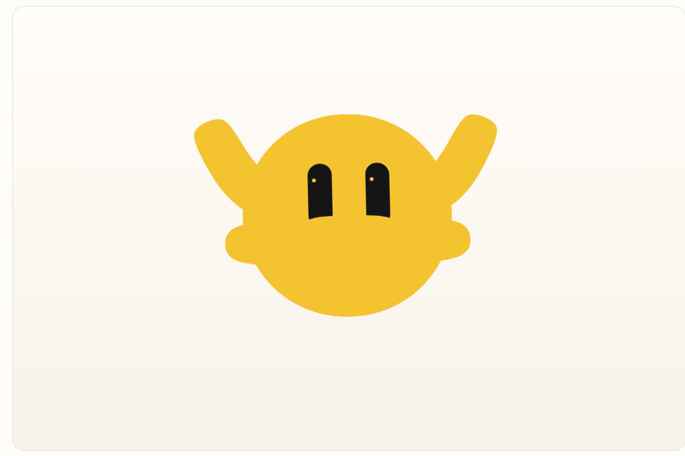

# Avatar Forge

一个 JSON 规范 + 渲染器的交互式 agent 头像工作台：**一条 SVG 路径 + 两只眼睛**，
颜色、体积、视角、凝视、眨眼和动效全部由运行时推断。

本项目是对 [DominikScholz/open-bot-avatar](https://github.com/DominikScholz/open-bot-avatar)
的**独立复刻实现**：同一条契约、同一类推断式体积与截面投影算法，代码是新写的，单包、无框架、
可测试、可导出。逆向拆解过程与结论见 [ANALYSIS.md](ANALYSIS.md)。



## 快速开始

```bash
npm install
npm run dev        # http://localhost:5173
npm test           # 29 个几何/校验/投影/帧用例
npm run build      # tsc --noEmit && vite build
```

## 它是什么

定义只描述几何：

```json
{
  "version": 1,
  "id": "ghost",
  "name": "Ghost",
  "body": { "path": "M24 48C24 27 35 12 50 12C65 12 76 27 76 48L77 79 ...Z" },
  "eyes": { "x": 50, "y": 42, "spacing": 16, "scale": 1.15 }
}
```

- 坐标固定在 `0 0 100 100`；`body.path` 是一条单色填充路径（nonzero；孔洞反向绕行）。
- `eyes.x/y` 是双眼中心，`spacing` 是中心距，`scale 1` 表示单眼约 4×11。
- 没有颜色、没有渐变、没有位图、没有动画——这些都属于宿主。

运行时做的事：

1. **推断体积**。每个填充子路径变成一块"部件"，按形状判定为圆角板（inflate）、绕自身竖轴的
   旋转体（revolve-y）或绕全身水平轴的旋转体（revolve-x），并用距离场推出前表面高度 `h(x,y)`。
2. **切成两叠普通截面**。`z` 切片是高度场的等值面（marching squares），`x` 切片是列剖面。
   渲染时挑更朝向观察者的那叠，正交投影后从后往前画——于是 3D 感来自 2D 路径，不需要 WebGL。
3. **贴眼睛**。眼睛最多放大 1.45 倍（受轮廓净空约束），贴在高度场的切平面上，按深度参与排序。
4. **驱动姿态**。确定性纯函数 `computePose(seed,time,state,mood,gaze,…)`：空闲呼吸/游走/眨眼，
   工作时有彩带扫过，思考时变成三个圆点，阻塞时变成感叹号，完成时在彩带笼里转几圈。
   圆身子的头像会按椭圆度放大压扁/拉伸与弹跳，读起来就是一颗橡皮球。
5. **表情是独立的第二轴**。状态决定"在干什么"，表情决定"看起来怎么样"，两者可任意组合
   （`working` + `love` 的星星眼照样扫彩带）。眼睛由六个参数描述——笑弧 `arc`、细缝 `slit`、
   睁大 `wide`、星光 `star`、垂眼 `lid`、倾斜 `tilt`——外加眨眼 `wink` 与高光 `glint`，
   全部逐点插值，所以换表情是"形变"而不是"换图"。

## 表情表

| 表情 | 眼睛 | 身体细节 |
| --- | --- | --- |
| 中性 `neutral` | 药丸眼 + 一点高光 | 呼吸、游走，每几秒闪一下微表情 |
| 开心 `happy` | 笑眼弧 | 空闲时会跳 |
| 困倦 `sleepy` | 上缘平、下缘圆的半闭眼 | 呼吸变慢、眨眼变长，偶尔点头打盹 |
| 惊讶 `surprised` | 睁大发亮 | 急停 + 轻微发抖 |
| 好奇 `curious` | 眼轴朝上、微睁 | 头歪一边，视线来回打量 |
| 不爽 `grumpy` | 细缝、内角朝下 | 身体压低、侧目 |
| 爱心 `love` | 四角星光 | 像心跳一样轻微搏动 |
| 眨眼 `wink` | 左眼闭、右眼笑弧 | 头微歪 |

完成态（`done`）不再用彩带笼，而是**粒子绽放**：34 粒从身体中心炸开，各自有延迟、速度、大小、寿命与旋向，
颜色取身体色的 OKLCH 色阶，往下的粒子画在身体前、往上的画在背后，随后缩没。

## 工作台功能

- 图库（38 个自研头像）+ 缩略图（先用剪影，空闲时升级成真正的 3D 静帧）
- 颜色（调色板 / 取色器）、体积深度、尺寸、状态 6 档、**表情 8 种**、跟随光标、减少动效
- 「逗它一下」：给一个 1.6 s 的瞬时反应（惊讶 / 爱心 / 不爽 / 好奇 / 眨眼 / 困倦）
- **姿态过渡**：状态与表情切换都从"屏幕上正在显示的那一帧"缓动 420 ms（smoothstep），中途再切会从当前进度继续
- 拖动舞台转身（叠加视角）
- 粘贴 JSON 导入（单条或数组）、字段级错误提示、`localStorage` 保存
- 导出 SVG（仍帧）与 1024×1024 透明 PNG
- 一键复制给模型的设计提示词

## 公网预览（可选）

```bash
scripts/publish.sh            # 构建 → 本地 preview(4173) → cloudflared quick tunnel，打印公网地址
```

quick tunnel 的域名是临时的（进程结束/重启会换新域名，也可能受速率限制）。需要固定地址就用
Cloudflare Named Tunnel（自己的域名）或 `tailscale funnel`。本地开发用 `npm run dev` 即可，不需要隧道。

## 代码地图

```
src/core/
  types.ts      契约与渲染选项
  path.ts       受限路径解析 / 展平 / nonzero 绕数 / 边表
  field.ts      最近边距离、marching squares、RDP、环 → 路径
  volume.ts     体积推断、双叠截面、细部细分、眼窝与眼平面
  validate.ts   校验、孔洞判定、眼睛净空与凝视行程
  pose.ts       确定性姿态与状态节拍
  eyes.ts       药丸/开心弧/细缝的逐点形变
  frame.ts      视图矩阵、帧装配与深度排序、彩带配色
  fx.ts         彩带几何、感叹号与三圆点
  paint.ts      canvas 渲染（位图 fit + Path2D 缓存）
  svg.ts        静帧导出
src/app/        工作台 UI（原生 DOM）
gallery/        12 个自研头像定义（由 scripts/gen-gallery.mjs 生成）
tests/          几何、校验、投影、帧、图库用例
```

## 与上游的差异

| 上游 | 本项目 |
| --- | --- |
| pnpm monorepo（core + React 站点） | 单包、原生 TS/DOM |
| 自带距离分桶索引（EdgeIndex/EdgeBands 分带） | 一遍算术的简单实现，结果相同、常数更大，靠缓存摊销 |
| CSS 3D `scene` 后端 + WebGL 绒毛材质 | 未复刻；canvas + SVG 两种后端 |
| 彩带由 3D 中线、切向与端帽构造 | 屏幕空间法线扩宽 + 可见性分段，视觉近似 |
| 状态切换在渲染器内做 `motionBlend` | UI 侧 420ms 参数插值 |

没有复制上游素材：`gallery/*.json` 全部由 `scripts/gen-gallery.mjs` 用图元（圆、椭圆、圆角矩形、
多边形、星形、Catmull-Rom 平滑 blob、环带）现场拼出来，并由测试逐条校验。
12 个形象分三组：信使线（`hermes` / `scroll`）、机舱线（`grok-pod` / `relay` / `mecha` / `droid` /
`orbiter`）、伙伴线（`neko` / `spark` / `guardian` / `ghost`（Phantom）/ `mochi`）。

### Hermes 系列（信使线）

以希腊信使赫尔墨斯的符号系统为母题，但只保留缩到 20px 还认得出的三样：**翅膀、杖、头盔轮廓**。

| 形象 | 母题 | 构图 |
| --- | --- | --- |
| `hermes` | 翼盔（petasos） | 圆盔当脸，两侧各一片羽翼，盔沿压出下颌 |
| `scroll` | 卷轴 | 纸面 + 两端卷边 + 飘带（消息本身） |

设计约束沿用契约：一个主导体（脸）+ 至多一件附属物，附属物根部要粗（不能是细鳍），
所有几何留在 8..92 内，眼睛必须是主导体上最实的一块。

## 契约要点（生成侧）

- 一条填充路径，绝对命令，允许子路径；孔洞反向绕行。
- 几何留在 `8..92`，长边 ≥40、短边 ≥14，填充面积 ≥600。
- 脸部是主导质量，眼睛四周留出 ~4 单位；两眼等高、关于 `eyes.x` 对称。
- 不要尖刺、细鳍、游离碎块：侧栏尺寸下读不出来。

工作台里的「复制设计提示词」就是给模型用的完整版本。

## License

MIT